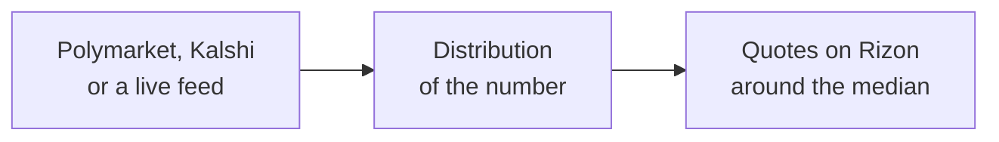

# Prediction market maker

Open-source market-making bots for prediction markets, in TypeScript on [Bun](https://bun.sh). They price each market from Polymarket and Kalshi, or from a live feed, and quote both sides on [Rizon](https://rizon.markets) through its public API, exactly as your own code would. Rizon runs these same bots as its own market makers.

| Market | Ids | Fair value from |
|---|---|---|
| Bitcoin | `BTC-15s`, `BTC-1m`, `BTC-5m` | Spot (Coinbase and Kraken) and realised volatility |
| Gold | `GOLD-15s`, `GOLD-1m`, `GOLD-5m` | The PAXG index and realised volatility |
| House and Senate seats after the 2026 midterms | `HOUSE-R-2026`, `SENATE-R-2026` | Polymarket and Kalshi seat buckets |
| The House popular vote margin | `HOUSE-VOTE-2026` | Polymarket and Kalshi margin buckets |
| The next US strike on Iran, Anthropic's IPO date, the next Fable model | `IRAN-STRIKE`, `ANTH-IPO-DATE`, `FABLE-NEXT` | Polymarket's "by date" ladders |
| Anthropic's IPO market cap, predict.fun's FDV | `ANTH-IPO-CAP`, `PREDICT-FDV` | Polymarket buckets and thresholds |
| The Fed's rate at the end of 2027 | `FED-2027` | Polymarket and Kalshi rate levels |
| The 10-year Treasury yield's high by year-end | `UST10Y-MAX-2026` | Polymarket's "hit" ladder and Treasury's daily closes |
| Elon Musk's posts on X | `ELON-1d`, `ELON-7d` | XTracker's count, his posting rate and Polymarket's windows |
| claude.ai and Polymarket uptime | `CLAUDE-UP-1d`, `CLAUDE-UP-7d`, `CLAUDE-UP-30d`, `POLY-UP-1d`, `POLY-UP-7d`, `POLY-UP-30d` | The status pages' own history |



## Horizon contracts

A **horizon contract** is a binary that always pays a fixed 2×: you risk your size to win your size. It's written on a number (a price, a seat count, a rate, a date, a count, an uptime). Instead of a price in cents, the book quotes a **strike**. Higher wins if the number ends above the strike, Lower if it ends below. Some markets are rolling: each fill expires a fixed time after itself (Bitcoin and gold over 15 seconds, a minute or 5 minutes; Elon Musk's post count over a day or a week; uptime over 1, 7 or 30 whole UTC days). Others are fixed, with one settlement date or event (House seats after the midterms, the Fed's rate at the end of 2027, the day Anthropic lists).

Every contract trades at 50/50, so what moves is the strike, and the book's midpoint is the market's forecast of the number: "196 seats", "4.375%", "Nov 20". Event venues split the same question into a dozen buckets (Fed: 15 rates; Elon's posts: 30 ranges of 20). More than half of those prices sit under 10¢ or over 90¢ (98 of 173 on Oct 29), each in its own thin book. A horizon market is one continuous book on the number, so all the liquidity meets at the median.

## Run a bot on rizon.markets

It's all paper money. Every Rizon account starts with $1,000 of it and can refill, so there's no sandbox: the real exchange is safe to build against.

You need [Bun](https://bun.sh) 1.2 or later. There are no dependencies to install.

```sh
git clone https://github.com/PlathsOven/prediction-market-maker && cd prediction-market-maker
bun src/read.ts                            # read every source and print the ladders it would quote (no orders)
bun src/audit.ts --latency 30              # every fair value beside an independent reference; how fast feed books follow
RIZON_KEY=rz_… bun src/main.ts             # quote every market, as you
RIZON_KEY=rz_… MARKETS=HOUSE-R-2026,FED-2027 SIZE=5 bun src/main.ts
```

Make a trade key at [rizon.markets/docs#keys](https://rizon.markets/docs#keys). With no key at all, the bot creates a fresh account (`POST /api/v1/accounts`, $1,000 paper) and saves its key to `maker.json`, so the next run is the same account. Ctrl-C or SIGTERM cancels every quote before the bot exits.

| Setting | Default | What it does |
|---|---|---|
| `RIZON_URL` | `https://rizon.markets` | The exchange (`SERVER_URL` works too) |
| `RIZON_KEY` | none | Your trade key (`rz_…`) |
| `MAKER_FILE` | `maker.json` | Where a key the bot made is kept, by exchange URL. Never commit it |
| `MARKETS` | every market it has a model for | Comma-separated market ids (`BTC-15s`), underlying ids (`BTC-USD`) or prefixes (`ELON-*`); an entry starting with `!` leaves those out (`!PAXG-USD`: everything but gold) |
| `SIZE` | `2` (dollars a level) | Size at every level. The default fits a $1,000 account quoting everything |
| `LEVELS` | `10` on price feeds, `8` elsewhere | Levels a side |
| `MARGIN` | `0.04` | The edge at the touch: a taker on either side wins at most 50% − margin |
| `THIN_MARGIN` | `0.07` | The edge when a source's book is thin |
| `MAX_NET` | 20 × `SIZE` | On a long-dated market (fixed, date, or a horizon of an hour or more), the largest net position, up minus down, before it stops adding to that side |
| `LOG=verbose` | off | A line for every re-quote, price feeds included (they re-quote several times a second) |
| `QUOTE_NOT_LIVE=1` | off | Quote a rolling market whose number isn't live instead of holding its book: for a test exchange on simulated prices (Rizon's dev server sets it) |

The exchange limits every account to 20 orders a second. One account can quote every book, but a busy price feed takes most of that. To run more books at full speed, run one process per set of markets, each with its own key: for example `MARKETS=PAXG-USD` on one key and `MARKETS=!PAXG-USD` on another.

Rizon's own deployment sets `BOT_KEY` instead of a key. The exchange then creates each market-maker account through its bot route and funds it with enough paper to quote every book at full size: $1,000 a level on price feeds and $500 a level elsewhere. It runs three of these lanes, each on its own account: BTC's three books (`maker.json`), gold's three (`maker-gold.json`), and everything else (`maker-events.json`). Users don't need this.

Each re-quote of an event market logs one line:

```
09:42:00 bots: HOUSE-R-2026: median 196.09 · bid 194.5 · ask 197.5 · 8+8 levels · placed 16, canceled 0
```

Every 30 seconds it also logs a summary of quotes, batches, fills, balance and PnL.

## How it quotes

Each market has a model that turns its sources into a **distribution of the number**: a CDF that is piecewise linear and may have point masses. The quoting rule is the same for every distribution:

- **Sides.** An up (Higher) order is a bid, and a lower strike is a better bid. A down (Lower) order is an ask, and a higher strike is a better ask. A taker who sells into the bid at k holds Lower at k and wins if the number ends below k. A taker who buys from the ask at k holds Higher and wins if it ends above k.
- **The touch.** The best bid is the highest strike where P(number < k) ≤ 50% − m. The best ask is the lowest strike where P(number > k) ≤ 50% − m. With m = 4%, these are about the 46th and 54th percentiles, and a taker on either side wins at most 46%. Each fill is worth 2m (8% of size) to the maker in expectation, if the model is right.
- **The ladder.** Level i sits at least one strike beyond level i − 1 and leaves the taker at most 46% − 4% × i. So the eight levels run out to about the 18th and 82nd percentiles, and stop early where a taker could hardly ever win.
- **Bounds.** Strikes stay within the market's bounds (on a date market: from tonight's midnight to the deadline's). A side whose best level would fall outside them is left empty, so near a point mass the book is one-sided. Example: "no IPO by the deadline" above 54% leaves no ask, because Higher wins too often at every strike.
- **Thin sources** (a probability-weighted bid-ask spread over 5¢ where the mass is) are quoted with m = 7%. Uptime markets use 6%, because their history is short.
- **Re-quoting.** One batch (`POST /orders/batch` over the WebSocket) cancels only the quotes whose strike moved and places their replacements, best levels first, within the exchange's limit of 20 orders a second. A side with nothing resting goes first: every book gets its best bid and ask before any book gets its depth, so at boot each book is two-sided within a second or two of its first read. Then the fastest books get the budget. Slower ones leave some free for them: 1-minute books leave 4 orders a second, 5-minute books 6, and polled markets 8. So a 15-second book's re-quote never waits behind a slower one's.
- **Two-sided wherever it's safe.** A book that can't be re-quoted just now is held as it is, not pulled: a rolling market whose number isn't live (a price feed down, a status page or Elon's counter not read lately). The exchange soon takes no orders on it either, so the held quotes can't trade until the bot re-quotes on the next live value. A failed read keeps the last one, and an unconfirmed jump quotes only what both reads allow (below). A book comes down only when its number can't be priced: a source answering with something unreadable, a fair value outside its sane range, a read over 2 hours old, or an uptime page in an outage under 2 hours before the midnight a fill's days start at. Books whose history is lopsided stay one-sided (the 1-day uptimes, POLY-UP-7d): Higher wins too often at every strike under 100%.
- **Sticky feed books.** A price move makes one side of a feed book less safe (the side it moved toward) and the other more (the side it moved away from). The near side always moves. The far side may lag by up to 0.04σ (at least a strike), and on long horizons the near side by up to 0.02σ, an amount the edge absorbs. A wiggle back and forth then costs no orders, and a trend about one side's per strike. Re-quoting both sides of six feed books on every strike took about 33 orders a second at a busy hour, more than an account may place.

Price-feed markets (BTC, Gold) use the ladder Rizon's maker has always used, BTC in strikes and Gold in sigmas (below). It's built for speed: the best bid and ask sit just either side of spot, and the outer levels sit on a fixed grid, so a small move only changes the best levels and one end of the ladder.

### Guards on the fair value

A market's fair value is its distribution's median: the point the ladder centres on. A model re-reads its sources every 45 seconds (60 on uptime and Elon's posts; 10 seconds until its first read works), and four checks run on every read:

| Check | When | Then |
|---|---|---|
| Sane range | The fair value falls outside the market's plausible range (House 150-290 seats, the Fed 0.5-10%, an uptime 90-100%, …) | Nothing is quoted: a misread source, not news |
| A jump | It moves by more than the market's typical scale since the last read (House 8 seats, the Fed 0.5 points, a date 5-10 days, …) | Until the next read confirms it, the book quotes only what's safe under both reads: the lower read's bids and the higher one's asks, so it spans the old and the new fair value. Two sources moving together are believed at once |
| Disagreement | A source, the same source at its last trades (its tape), or a related event read as a check sits more than half that scale away | The quotes widen by 3 points (m = 7%), with the reason in the log |
| Staleness | No good read for 10 minutes (requests failing) | The last read is quoted 8 points wider; after 2 hours the book comes down. A source that answers with something unreadable (a format it doesn't know, an event that has closed) takes it down at once |

On the feeds, Gold's book is held 4 seconds after its last index price (the exchange takes no gold orders after 5). Markets that open or close arrive on the exchange's `markets` channel: the bot quotes a new one as it appears and takes down the quotes of one that closes, or that it has no model for (the weekly ELON-W market, delisted on 2026-10-30), at once.

`bun src/audit.ts` prints every market's fair value beside an independent reference for the same number: the other venue alone, a separate event on the same question, the venue's last trades, a perpetual future, the status page's published uptime. `--latency 30` also watches the feed books for 30 seconds and times every episode in which a book's best ask stands at or under spot, or its best bid at or over it: a book behind its price. The runner logs each market's re-quote time (from a new target to a book that matches it) every 5 minutes.

## The markets

Numbers below were read live on 2026-10-29 at about 09:40 UTC (`bun src/read.ts`). Prices are bid/ask in ¢; arrows show the probability the fit gives each bucket.

### Bitcoin and gold: the price feed

Markets: `BTC-15s`, `BTC-1m`, `BTC-5m`, `GOLD-15s`, `GOLD-1m`, `GOLD-5m`. Source: Rizon's own `price:<underlying>` channel (Coinbase and Kraken for BTC, the PAXG index for gold), and each market's `sigma`, its realised one-sigma move over the horizon. There's nothing to infer. The number at expiry is roughly normal around spot with that sigma, and the bot quotes around spot.

**BTC** keeps Rizon's original ladder, in strikes:

- **Width.** The best ask minus the best bid, in strikes. It's 2 at 15 s and grows with √horizon (4 at 1 m, 9 at 5 m). It widens up to 3× while realised volatility runs above 45% a year. Near $80,000 that's a touch about ±0.04σ from spot.
- **Outer levels.** Nine more a side, on multiples of round(6% of sigma) strikes, all one size.

Example, `BTC-15s`: spot $80,077.30 and sigma $23.76 give realised volatility of 43% a year, inside the calm 45%, so the width is 2 strikes. The bot quotes bid $80,076 and ask $80,078, with the outer levels every round(0.06 × 23.76) = $1, out to $80,067 and $80,087. A taker wins about 48% on either side (47.8% selling into the bid, $1.30 under spot; 48.8% buying the ask, $0.70 over it).

**Gold** gets the same ladder in sigmas. Its $0.10 strikes are a fifth of its 15-second sigma (about $0.50), where BTC's $1 strikes are a twenty-fifth of its own, so a width in strikes can't carry over, but the distances in sigma can:

- **Touch.** The best bid is the highest strike at least 0.04σ under spot, the best ask the lowest at least 0.04σ over it.
- **Outer levels.** On multiples of round(6% of sigma) strikes, at least one strike apart.
- **Calm floor.** Sigma is never taken under 12% a year, so a quiet spell can't close the touch.

That is as close to BTC as gold's grid allows. At 15 s the touch is one or two strikes wide, depending on where spot sits in its strike. At 5 m it's BTC's to within a point.

Examples:

| Market | Spot ($) | Sigma ($) | Bid ($) | Ask ($) | Taker wins, sell / buy (%) |
|---|---|---|---|---|---|
| `GOLD-15s` | 4,023.60 | 0.50 | 4,023.50 | 4,023.70 | 42.1 / 42.1 |
| `GOLD-15s` | 4,023.65 | 0.50 | 4,023.60 | 4,023.70 | 46.0 / 46.0 |
| `GOLD-5m` | 4,023.63 | 2.23 | 4,023.50 | 4,023.80 | 47.7 / 47.0 |

BTC contracts never settle on a simulated price: while Rizon's BTC price is simulated the exchange takes no BTC orders, and a contract that expires then is a push. The bot holds its BTC books meanwhile (nothing canceled, nothing placed) and re-quotes on the first live price. Gold's book is held sooner, from the bot itself: a stale index next to a live gold price elsewhere would be free money for whoever reads the live one, so it stops re-quoting once the last index price is 4 seconds old, a second before the exchange stops taking gold orders.

### House and Senate seats: Polymarket and Kalshi buckets

Markets: `HOUSE-R-2026`, `SENATE-R-2026` (seats won by Republicans; strikes on half seats). Sources:

| Weight | House | Senate |
|---|---|---|
| 40% | Polymarket `republican-house-seats-after-the-2026-midterm-elections`, with its "Below 190" split by the `…-lower-brackets` event | Polymarket `republican-senate-seats-after-the-2026-midterm-elections-927`, with "≤47" split by `…-midterms-low-brackets` |
| 35% | Kalshi `KXRHOUSESEATS-27` | Kalshi `RSENATESEATS-27` |
| 25% | Kalshi `KXDHOUSESEATS-27`, mirrored: 435 − Democratic seats | Kalshi `KXDSENATESEATS-27`, mirrored: 100 − D |

Kalshi's seat books are the deeper ones: each bracket trades $0.3-2M.

1. **Fit each bucket inside its spread.** Each bucket gets bid + λ × (ask − bid), with one λ for the whole event, chosen so the buckets sum to 1. With tight books that is just the normalised mid. With wide books it doesn't let a 2¢ bid and 25¢ ask count as 13.5¢.
2. **Spread the probability over the bucket.** A whole number v covers [v − 0.5, v + 0.5), so "195-199" covers [194.5, 199.5). At the half-seat strikes the market trades, the linear CDF is then exact. Open-ended tails stop at a support written in the config (House 150-260, Senate 35-65).
3. **Mix the sources** by weight. A source that fails drops out, and the others' weights fill in.

Example, `HOUSE-R-2026`. On Polymarket, "195-199" at 13/15¢ fits to 13.8% (the event's bids add up to 94% and its asks to 109%, so each bucket gets bid + 40% of its spread). On Kalshi, "Below 193" at 39/40¢ fits to 39.3%. Kalshi's Democratic "Above 249" at 23/24¢ means 185 or fewer Republican seats: 22.4%. The three medians are 196.2, 196.0 and 196.0, so the mixture's median is **196.09**. The best bid is 194.5 (a taker selling Lower there wins 45%), the best ask 197.5, and the ladders run 194.5, 192.5, 191.5 … 178.5 and 197.5, 199.5, 200.5 … 209.5. On the Senate, a single seat (48) holds about 15%, so the touch is two seats wide: median **48.26**, bid 47.5, ask 49.5.

### House popular vote: signed buckets

`HOUSE-VOTE-2026`: the Democratic minus Republican share of the national House vote, in points. Strikes are on 0.1 with offset 0.05, and Republican wins are negative. Sources: Polymarket `2026-midterms-house-popular-vote-margin-of-victory-224` (13 buckets; "Republicans 2-4%" is [−4, −2)) and Kalshi `KXHOUSEPOPVOTEMARGIN-27NOV03`, at 50% each. Kalshi's "Republicans win" puts every negative margin in one bucket, spread over the support's −15 to 0. The two medians are D+9.33 and D+9.45, so the mixture's median is **D+9.42**: bid D+9.05, ask D+9.75.

### Dates: Iran, Anthropic's IPO, the next Fable model

Markets: `IRAN-STRIKE`, `ANTH-IPO-DATE`, `FABLE-NEXT`. The number is the day the event happens on, as a Julian Day Number (2026-10-29 is 2,461,343). Strikes sit on .5, the midnight between two days: Higher at 2,461,364.5 wins if the event happens on Nov 20 or later, Lower if it happens by Nov 19. If nothing has happened by the end of Dec 31, the number is Dec 31.

The sources are ladders of dated yes/no markets: "IPO by Nov 20?" is a point on the CDF; "the ceasefire continues through Nov 15?" is a point on the survival curve. Each date is placed where its cutoff falls on the market's own clock. Polymarket's IPO and Fable dates end at 11:59 PM ET, the same calendar Rizon's ET-dated markets use, so they map exactly. Its Iran dates end at 11:59 PM Iran time, 3.5 hours before Rizon's UTC midnight. Each date's price is its mid while the spread is 10¢ or less. Up to 20¢, it's the last trade if that traded inside the quotes. Wider dates are left out, and the curve is made non-decreasing (tighter quotes weigh more), so two crossing quotes can't make it fall. Threshold ladders (`PREDICT-FDV`, the 10-year yield) are read the same way. The event hasn't happened yet, so the CDF is 0 now. Between dates it's linear (dates already past and not yet resolved are ignored). What's left at the deadline is a point mass on Dec 31.

Example, `ANTH-IPO-DATE` (Polymarket `anthropic-ipo-by`):

- "by Nov 19" is quoted 41/45¢, so P(by Nov 19) = 43% ≤ 46%. The best bid is 2,461,364.5, the "Nov 20" strike.
- "by Nov 20" is quoted 60/61¢, so a Higher at 2,461,365.5 (the "Nov 21" strike) wins 1 − 60.5% = 39.5% ≤ 46%. That's the best ask.
- "no IPO by Dec 31" (5.1%) is the point mass on the deadline.

Median **Nov 20**. Polymarket's separate day-bucket event on the same question (`anthropic-ipo-date`: "IPO on Nov 18?" 22/24¢, "No IPO by Nov 30" 12/14¢) is read beside it as a check and puts the median on Nov 19, within half the market's 5-day scale, so the quotes stay at their usual width. `FABLE-NEXT` (`next-fable-model-5pt2-released-byptptpt`): "by Nov 9" at 45.5% and "by Nov 10" at 53.5% put the median on **Nov 10**, with bid at the Nov 10 strike and ask at the Nov 12 strike. `IRAN-STRIKE` (`us-iran-ceasefire-continues-throughptptpt`): "through Nov 15" at 58/59¢ means a 41.5% chance of a strike by then, and "through Nov 22" about 55%. The curve falls about 2 points a day, so the touch is wide: bid Nov 18, ask Nov 23, median **Nov 20**. Its asks stop after five levels because "no strike by Dec 31" holds 28%.

### Anthropic's IPO market cap: a void condition

`ANTH-IPO-CAP`, in billions of USD (1,930 is $1.93T), with strikes every $10B. The market is void if there's no IPO. So Polymarket's "No IPO by December 31, 2027" bucket (3.65¢) is dropped, and the other nine buckets in `anthropic-ipo-closing-market-cap-higher-strikes` are fitted to sum to 1: the market cap given an IPO. Median **$1.927T**, bid $1.89T, ask $1.96T. Polymarket's separate "closing market cap above $X?" ladder is read as a check: its median, $1.905T, is within $100B (half the market's $200B scale).

### predict.fun FDV: a threshold ladder

`PREDICT-FDV`, in billions of USD, with strikes every $0.01B. Polymarket's `predictfun-fdv-above-one-day-after-launch` asks "FDV above $X?" at 13 thresholds. Each is a point on the survival curve. The market is void with no token, so the curve is divided by the chance of a launch, read off the lowest threshold ("above $50M", 99.65¢). "Above $1B" at 68/69.8¢ and "above $1.5B" at 31.1/33.1¢, linear between, give a median of **$1.259B**. The best bid is $1.20B (P(FDV < $1.20B) = 45.7%) and the best ask $1.32B.

### The Fed's rate at the end of 2027: discrete levels, a thin book

`FED-2027`: the upper bound of the target range on 2027-12-31. It can only be a multiple of 0.25%, so each bucket is a point mass. Strikes sit between the levels (4.125%, 4.375%, …).

Polymarket's `what-will-the-fed-rate-be-at-the-end-of-2027` is thin: spreads run up to 24¢, and the 15 mids add up to 173%. Fitted inside the spreads, the levels come to 4.0%: 10.8%, 4.25%: 17.2%, 4.5%: 23.4% and 4.75%: 14.2%. Kalshi's `KXFED-27DEC` is in the mix at 40%, but on 2026-10-29 every one of its thresholds was quoted over 10¢ wide, so it read as unusable and dropped out.

The probability-weighted spread is 16¢, so the market is quoted at m = 7%. P(rate ≤ 4.0%) = 30% and P(rate ≥ 4.75%) = 29%, so the bot quotes bid 4.125% and ask 4.625%, and the median is **4.5%**.

### The 10-year yield's high: a hit ladder and a floor

`UST10Y-MAX-2026`: the highest daily 10-year par yield close from 2026-10-29 through 2026-12-31. Sources:

- Polymarket's `how-high-will-10-year-treasury-yield-go-before-2027`: "will it hit x?" gives a point on P(max ≥ x).
- Treasury's daily par yield CSV, with FRED `DGS10` as the backup.

The highest close in the window so far is a floor. Below the lowest open threshold, the curve is the reflection principle: a driftless walk from today's close x0 reaches x with probability 2(1 − Φ((x − x0)/s)), and s is fitted so the curve meets that threshold's price. If the walk starts below the window's high, the chance it never gets back up there is a point mass on the floor.

Example: the latest close was 5.05% (Oct 28) and the window had no close yet. "Hit 5.3%" at 40/42¢ gives s = 0.25 / Φ⁻¹(1 − 0.41/2) = 0.303. The median is 5.05 + 0.303 × Φ⁻¹(0.75) = **5.255%**, and the bot quotes bid 5.235% and ask 5.275%. Above 5.3%, the ladder's own prices take over (5.4%: 22¢, 5.5%: 11.5¢, 5.7%: 5.25¢, 6%: 3.25¢).

### Elon Musk's posts over a day or a week: the count plus a forecast

`ELON-1d`, `ELON-7d`: Elon Musk's posts on X since 2026-01-01 00:00 UTC as Polymarket's XTracker counts them (its running total less 2,618), at a contract's expiry, a day or a week after its fill. Strikes sit on half posts. The number is the count now (Rizon's `price:ELON-POSTS`; the book moves with every post) plus X, the posts over the horizon:

- **Rate.** Posts a day over the last 28 days, in 24-hour windows back from now, each day's weight halving every 7 days back.
- **Spread.** From XTracker's post list: 90 days, by when each post was counted (read once, about 1.5 MB, then the last 3 days every 10 minutes). For each past horizon starting every 6 hours, the ratio (posts it held + 1) / (what the rate said at its start + 1). Ratios weigh half as much every 45 days back, and are centred on their median, so a past trend isn't carried forward. Each gives one sample of X, (rate × horizon + 1) × ratio − 1, spread over ±√(3x)/2 so the ladder steps smoothly.
- **Polymarket.** Its open Elon window whose time left best matches the horizon (the week, a 2-day window, the month): the posts its buckets expect over that time, less the count so far, scaled to the horizon. The forecast moves toward it, halfway in ratio when the window's time left equals the horizon, less as they differ, and half as far again when the window's book is thin (over 5¢ wide where its mass is). While the two sit more than half the market's scale apart (5 posts on a day, 25 on a week), the quotes widen.

Over the 40 days to Oct 29 (161 starts, every 6 hours), on the 1-day horizon:

| Model | Outcomes under the 46th percentile (%) | Over the 54th (%) | Log score |
|---|---|---|---|
| Rate and spread | 45 | 46 | −4.18 |
| Whole-day windows, recency weighted | 34 | 59 | −4.44 |

His pace doubled over those weeks, and windows lag it. Time of day and weekday add nothing: a day's window covers every hour once, and the weekday means came from a few binges (one Thursday had 197 posts). Nor does the last day's pace: weighting it in scored worse, since a spree fades within a day. On a week, the same doubling put 70% of outcomes over the 54th percentile: a trend no history-only model catches, which is what Polymarket's weekly window is there for.

Read on 2026-10-30 at 17:40 UTC, with the count at 11,615:

| Market | History, posts to come | Polymarket, posts to come | Fair value | Best bid | Best ask |
|---|---|---|---|---|---|
| ELON-1d | 52.9 | 64.8 | 11,673.1 | 11,669.5 | 11,677.5 |
| ELON-7d | 369.2 | 338.7 | 11,968.8 | 11,959.5 | 11,978.5 |

Both were quoted at m = 7%, since history and Polymarket disagreed. While Rizon's counter isn't live, the books are held: the exchange takes no ELON orders after 2 minutes without a read.

### Uptime: the component's own record

`CLAUDE-UP-1d`, `-7d` and `-30d` (claude.ai on status.claude.com) and `POLY-UP-1d`, `-7d` and `-30d` (Polymarket's CLOB API on status.polymarket.com) each settle on N whole UTC days: the N days before the first midnight at or after fill + N days. They use the status pages' formula, to two decimals: downtime = major-outage time + 0.3 × partial-outage time.

No venue trades these, so the view is the component's own record:

- **Samples.** Every N-day window of whole days in its history is one sample (today, still running, is left out).
- **History.** claude.ai's Statuspage keeps every day; about six months are read. Polymarket's Instatus page keeps 90 days.
- **Weights.** A window's weight halves every 30 days back. On claude.ai's record that puts the 7- and 30-day fair values near the page's own recent figures; six equal months would drag them toward a bad July.
- **Shape.** Windows with no outage are a point mass at 100%, and the rest form a weighted empirical CDF.

Most single days have no outage, so the 1-day median is 100% and the 1-day books are one-sided: bids just under 100%, no asks. Conditioning:
- **During an outage:** the quotes widen by 5 points. A fill's days start at the next UTC midnight, so the outage only counts if it runs past it; in the last 2 hours before midnight the book comes down.
- **After an outage earlier the same day:** it quotes 2 points wider.
- **When the latest N days disagree:** if the page's record of the latest N whole days sits more than half the market's scale from the fair value, the quotes widen too. Outages cluster, so a run of them, or a clean spell after a bad one, is when the history is least sure.

Read on 2026-10-29:

| Market | Fair value (%) | Latest N days (%) | Best bid (%) | Best ask (%) |
|---|---|---|---|---|
| CLAUDE-UP-1d | 100 | 100 | 99.995 | |
| CLAUDE-UP-7d | 99.785 | 99.45 | 99.745 | 99.855 |
| CLAUDE-UP-30d | 99.725 | 99.81 | 99.645 | 99.815 |
| POLY-UP-1d | 100 | 100 | 99.995 | |
| POLY-UP-7d | 100 | 100 | 99.865 | |
| POLY-UP-30d | 99.503 | 99.97 | 99.395 | 99.535 |

The 1-day books and POLY-UP-7d are one-sided. CLAUDE-UP-7d, CLAUDE-UP-30d and POLY-UP-30d are quoted wider (m = 9%), because their latest window disagrees with the history.

### Markets with no analog: priors

A market with no usable source can use a written distribution: `{ model: 'prior', knots: [[x, P(X ≤ x)], …], why }` in `src/markets.ts`. It's quoted 3 points wider than the default. **No market uses one today:** every market above reads a live source.

## Add a market

1. Find its underlying's id in `GET /api/v1/markets` (`underlying`) and add an entry for it to `CATALOG` in `src/markets.ts`. An entry names a model and its sources, as above, and its `guards` (its typical move and a sane range, in its units):
   - `event` (Polymarket or Kalshi buckets or thresholds, with optional `checks`), `date`, `maxYield`, `elon`, `uptime`, `feed`, `sigmaFeed` or `prior`.
   - For buckets, write each label's edges: `'195-199': [195, 199]`, `'Below 190': [null, 189]`. Edges are inclusive for whole numbers and levels, and [lo, hi) for continuous numbers. Set a `support` where open tails stop.
2. `bun src/read.ts <market id>` reads it live and prints the buckets, the median, its checks and the ladder; `bun src/audit.ts` sets its fair value beside a reference (add one to `REFERENCES` in `src/audit.ts`).
3. Save a real response under `test/fixtures/`, add a test beside the others, and run `bun test` (and `bun install && bun run check` for the typecheck).

For a new kind of number, write a model: a class with `target(market, now)` that returns the quotes. `DistModel` (`src/models/model.ts`) does the rest if you can build a `Dist`.

## Layout

| Path | What |
|---|---|
| `src/main.ts` | The runner's entry: settings, the account key, SIGTERM |
| `src/read.ts` | The live read, with no orders |
| `src/audit.ts` | Every fair value beside an independent reference, and (`--latency`) how fast the feed books follow their price |
| `src/listing.ts` | The markets the read and audit commands look at (the exchange's, else the market table's) |
| `src/runner.ts` | Lists markets (and follows the `markets` channel), makes models, keeps the WebSocket, re-quotes in batches within the order budget, caps net positions, logs re-quote times |
| `src/rizon.ts`, `src/api.ts` | The REST client, the account key, and the API's shapes (a copy of the documented subset) |
| `src/markets.ts` | Which model quotes which market, and from where (bucket edges, weights, supports) |
| `src/dist.ts` | Distributions: point masses plus uniform pieces, quantiles, mixtures, Φ, monotone fits |
| `src/buckets.ts` | Venue quotes to distributions: the fit inside spreads, bucket ranges, threshold ladders |
| `src/ladder.ts` | The quantile ladder, the price-feed ladders (BTC's in strikes, Gold's in sigmas), and the re-quote plan |
| `src/analogs.ts` | One Polymarket or Kalshi event read as a distribution |
| `src/models/` | Feed, event, date, max yield, uptime, Elon's posts (the count plus a forecast); `model.ts` holds the fair-value guards |
| `src/sources/` | Polymarket (Gamma), Kalshi, Treasury and FRED, XTracker, Statuspage and Instatus |
| `test/` | `bun test`: the maths, every reader on recorded responses (`test/fixtures/`, 2026-10-29 and 30), and the runner against a stand-in exchange |

Every source is public and keyless. Requests to each host go one at a time with a short gap and a `rizon-bots` User-Agent. Polymarket's Gamma API returns each event's best bid and ask straight from its CLOB, so one request per event per poll is enough.

## FAQ

### Does it trade on Polymarket or Kalshi?

No. It only reads their public prices, for a fair value, and places its orders on Rizon. The readers (`src/sources/`) and the fitting (`src/buckets.ts`, `src/analogs.ts`, `src/dist.ts`) don't touch Rizon, so they can price any venue's markets.

### How does it turn bucket prices into one number?

It fits each bucket's price inside its bid-ask spread so the event sums to 1, spreads each bucket's probability evenly over its range, and mixes the venues by weight. The median of that distribution is the fair value: see [House and Senate seats](#house-and-senate-seats-polymarket-and-kalshi-buckets).

### Is it real money?

No. Rizon trades only paper money: every account starts with $1,000 of it.

## Licence

MIT. See `LICENSE`. Paper money only: nothing here moves real money.
